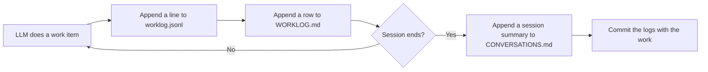

# Logs

This folder has three logs. The work log and the conversation log are append-only. The revisit log changes the status of items, but never deletes them.

| File | What it records | Who reads it |
|---|---|---|
| [`worklog.jsonl`](worklog.jsonl) | Each work item that an LLM (or {{DECIDER}}) does: what, why, how, when. Source of truth. | Scripts, LLMs |
| [`WORKLOG.md`](WORKLOG.md) | The same entries as a table for humans. | Humans |
| [`CONVERSATIONS.md`](CONVERSATIONS.md) | One summary for each session: {{DECIDER}}'s ideas, decisions, and reasons, then what the LLM did. | {{DECIDER}}, LLMs, later study |
| [`REVISIT.md`](REVISIT.md) | Ideas that can change the scope, with {{DECIDER}}'s decision: adopted, parked, or rejected. Not append-only: items change status. | {{DECIDER}}, LLMs |

This diagram shows when to write each log.



## Rules

1. Add a work log entry for each work item: plan, feature, fix, refactor, docs, operations, or ship.
2. Add the entry in the same commit as the work.
3. Do not edit or delete an old entry. To correct an entry, add a new entry with type `correction`. Put the old `id` in `refs`.
4. Use local time in ISO 8601 format with the UTC offset, for example `2026-01-15T16:28:05-08:00`. Get it with `date -Iseconds`, with `TZ` set to {{DECIDER}}'s time zone.
5. Follow the writing rule in CLAUDE.md.
6. At the end of each session, add one summary to `CONVERSATIONS.md`.
7. If an idea can change the scope, follow the process in `REVISIT.md`. Only {{DECIDER}} decides.

## Work log entry schema

Each line of `worklog.jsonl` is one JSON object.

| Field | Type | Required | Meaning |
|---|---|---|---|
| `id` | string | yes | `WL-NNNN`. Increase by 1 for each entry. |
| `ts` | string | yes | Time of the work. ISO 8601 with the UTC offset. |
| `session` | string | yes | `S-NNN`. Same value as the session in `CONVERSATIONS.md`. |
| `actor` | string | yes | `human`, `llm`, or `llm:<role>` (for example `llm:qa`). |
| `type` | string | yes | `plan`, `feat`, `fix`, `refactor`, `docs`, `ops`, `ship`, or `correction`. |
| `what` | string | yes | What was done. One or two sentences. |
| `why` | string | yes | Why it was done. Link the decision, plan, or request. |
| `how` | string | yes | How it was done. Main steps or method. |
| `files` | array of strings | yes | Files changed. Can be empty. |
| `commit` | string or null | yes | Commit hash. Use `null` if the entry is in the same commit as the work. Find that commit with `git log -- docs/log/worklog.jsonl`. |
| `refs` | array of strings | yes | Links: decisions (D1), ADRs, plans, PRs, other entry ids. Can be empty. |

## Conversation summary format

Use these headings for each session in `CONVERSATIONS.md`:

```markdown
## S-NNN: <title> (YYYY-MM-DD)

**{{DECIDER}}'s goals.** What {{DECIDER}} wanted from the session.

**{{DECIDER}}'s ideas and reasons.** The main ideas, in {{DECIDER}}'s words where possible. Why {{DECIDER}} chose them.

**Decisions.** The decisions made, with ids (D#) and links.

**What the LLM did.** The actions, and how they followed {{DECIDER}}'s input.

**Open items.** What is not done. What the next session starts with.

**Notes for learning.** What worked and what did not, for {{DECIDER}} and for the LLM.
```
